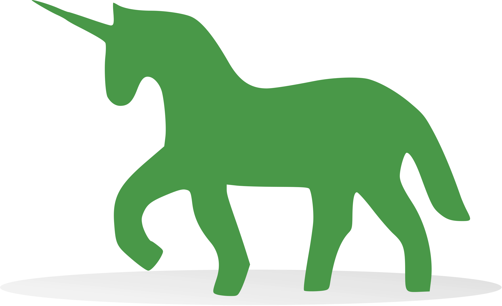

# Serving Machine Learning Models through RESTish APIs using Flask in Python

| Key             | Value                                                                                                                                                                                                                                                                                     |
|:----------------|:------------------------------------------------------------------------------------------------------------------------------------------------------------------------------------------------------------------------------------------------------------------------------------------|
| **Course Code** | BBT 4206                                                                                                                                                                                                                                                                                  |
| **Course Name** | BBT 4206: Business Intelligence II (Week 4-6 of 13)                                                                                                                                                                                                                                       |
| **Semester**    | September to December 2026                                                                                                                                                                                                                                                                |
| **Lecturer**    | Allan Omondi                                                                                                                                                                                                                                                                              |
| **Contact**     | aomondi@strathmore.edu                                                                                                                                                                                                                                                                    |
| **Note**        | The lecture contains both theory and practice.<br/>This notebook forms part of the practice.<br/>It is intended for educational purposes only.<br/>Recommended citation: [BibTex](https://raw.githubusercontent.com/course-files/ServingMLModels/refs/heads/main/RecommendedCitation.bib) |

## Technology Stack

<p align="left">





</p>

## Repository Structure

```text
.
├── LICENSE
├── Procfile
├── README.md
├── RecommendedCitation.bib
├── admin_instructions
│   ├── 0_instructions_for_project_setup.md
│   ├── 1_instructions_for_python_installation.md
│   └── 2_instructions_for_project_teardown.md
├── api.py
├── app_server_reverse_proxy_server_setup.md
├── assets
│   └── images
├── check_port_5000.py
├── cleanup_instructions.md
├── docker-compose-dev.yaml
├── docker-compose-prod.yaml
├── docker-compose.yaml
├── dockerfiles
│   ├── Dockerfile.flask-gunicorn-app
│   ├── Dockerfile.nginx
│   └── ubuntu
│       ├── Dockerfile.ubuntu
│       └── entrypoint.sh
├── env.example
├── fastapi-version
│   ├── Dockerfile.fastapi-uvicorn-app
│   ├── Procfile
│   ├── README.md
│   ├── api_consumer_from_dev_fastapi.py
│   ├── api_fastapi.py
│   ├── docker-compose-fastapi.yaml
│   └── requirements.txt
├── frontend
│   ├── api_consumer.py
│   ├── api_consumer_from_dev_flask.py
│   ├── ecommerce_recommender.html
│   ├── index.html
│   ├── mall_customer_segmenter.html
│   ├── sme_credit_risk_classifier.html
│   └── sme_revenue_regressor.html
├── huggingface-spaces-using-gradio
│   ├── app.py
│   └── requirements.txt
├── lab_setup.sh
├── lab_submission_instructions.md
├── lab_submission_marking_guide.md
├── lab_teardown.sh
├── model
│   ├── apriori_recommendation_rules.joblib
│   ├── kmeans_mall_customer_segmentation.joblib
│   ├── lasso_regressor_for_sme_revenue.joblib
│   └── svc_classifier_for_sme_credit_risk.joblib
├── publicly_serving_the_model_for_validation_by_domain_experts.md
├── requirements
│   ├── base.txt
│   ├── colab.txt
│   ├── constraints.txt
│   ├── dev.inferred.txt
│   ├── dev.lock.txt
│   ├── dev.txt
│   └── prod.txt
├── roughwork
│   ├── Docker-Compose-without-https.yaml
│   ├── OLD_Dockerfile.flask-gunicorn-app
│   ├── claude
│   │   ├── Dockerfile.flask-gunicorn-app
│   │   ├── Dockerfile.nginx
│   │   ├── app_server_reverse_proxy_server_setup.md
│   │   ├── docker-compose-dev.yaml
│   │   ├── docker-compose-prod.yaml
│   │   ├── docker-compose.yaml
│   │   └── nginx.conf
│   ├── frontend-OLD
│   │   ├── api_test_DT_classifier.html
│   │   ├── api_test_DT_regressor.html
│   │   └── index.html
│   ├── model-OLD
│   │   ├── decisiontree_classifier_baseline.pkl
│   │   ├── decisiontree_regressor_optimum.pkl
│   │   ├── knn_classifier_optimum.pkl
│   │   ├── label_encoders_1b.pkl
│   │   ├── label_encoders_2.pkl
│   │   ├── label_encoders_4.pkl
│   │   ├── label_encoders_5.pkl
│   │   ├── naive_Bayes_classifier_optimum.pkl
│   │   ├── onehot_encoder_3.pkl
│   │   ├── random_forest_classifier_optimum.pkl
│   │   ├── scaler_4.pkl
│   │   ├── scaler_5.pkl
│   │   └── support_vector_classifier_optimum.pkl
│   ├── nginx-without-https.conf
│   └── requirements.txt
├── rules
├── runtime.txt
└── streamlit-sharing-using-streamlit
    ├── app.py
    └── requirements.txt

17 directories, 81 files
```

## Setup Instructions

- [Setup Instructions](./admin_instructions/0_instructions_for_project_setup.md)

## Lab Manual

Refer to the files below, in the order specified, for more details:

1. [api_consumer.py](frontend/api_consumer.py) ← How to use `requests` in Python
2. [api.py](api.py) ← How to create a RESTish API using Flask in Python
3. [api_consumer_from_dev_flask.py](frontend/api_consumer_from_dev_flask.py) ← How to consume the RESTish API from a Flask development server
4. [index.html](frontend/index.html) ← Example of a frontend (HTML, CSS, and JS) that consumes from the API endpoint
5. [Reverse Proxy Server and Application Server Setup](app_server_reverse_proxy_server_setup.md) ← How to use Nginx as a reverse proxy server to serve the Flask application through Gunicorn
6. [Publicly Serving the Model for Validation by Domain Experts](publicly_serving_the_model_for_validation_by_domain_experts.md) ← How to serve the model through Hugging Face, Streamlit, and Render
7. [From Flask to FastAPI](fastapi-version/README.md) ← How FastAPI can be used to serve the model through Uvicorn instead of using Flask through Gunicorn

## Lab Submission Instructions

- [Lab Submission Instructions](lab_submission_instructions.md)

## Cleanup Instructions (to be done after submitting the lab)

- [Cleanup Instructions](/admin_instructions/2_instructions_for_project_teardown.md)
